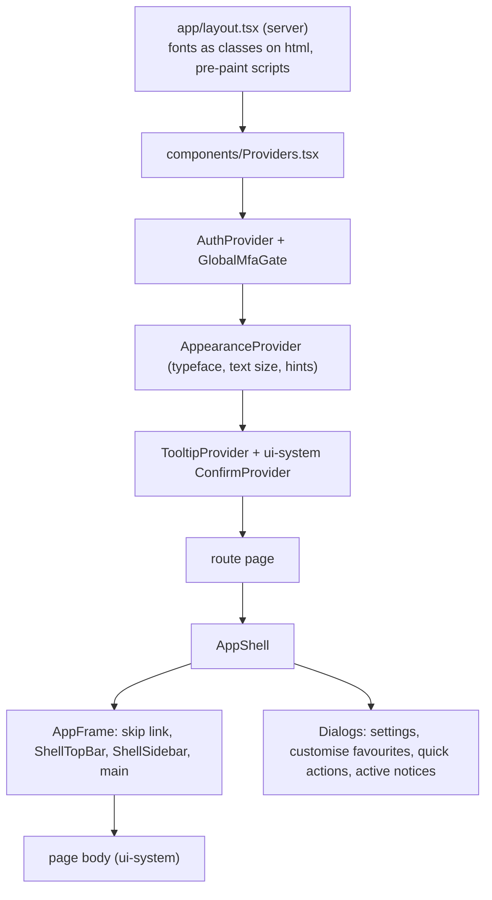

# Frontend UI architecture

**Status:** active architecture. Rewritten 3 Oct 2026; appearance layers and shared accessibility contracts refreshed
1 Nov 2026. The retired Classic/Dallaglio model does not describe the current system.
**Scope:** all MyOffice frontend routes.
**Related:** component contracts in [`components/ui-system/README.md`](../components/ui-system/README.md); current work in
[`CURRENT_HANDOFF.md`](./CURRENT_HANDOFF.md); per-route status in [`MIGRATION_LEDGER.md`](./MIGRATION_LEDGER.md).

## Decision

MyOffice uses one layered, open-code UI system derived from the Tools & Equipment workspace:

1. **Radix UI** supplies accessible interaction primitives (dialog, popover, select, menu, tabs, tooltip, alert dialog).
2. **`components/ui-system/`** is the owned design system built on Radix, Tailwind 4 and semantic CSS variables. It is the
   only system new work uses.
3. **`components/app-shell/`** is the application chrome (top bar, sidebar, settings, notifications, feedback, account)
   composed from the system. It is application code, not part of the system.
4. There is no other design system. The legacy one (`components/shared/design-system/`, the `${t.*}` token layer, the `.oz-*`
   classes, `components/ui/`) was deleted on 4 Oct 2026; the shared bits that remain (`components/shared/`) are built from
   `ui-system`.
5. `/tools` keeps its workspace-specific components and behaviour. `ToolsFrame` composes shared navigation primitives;
   its forms already use shared fields, inputs, checkboxes and dialogs. Semantic icon meanings pass directly to `NavItem`
   so the shared navigation weight applies. Preserve the Tools workspace boundary.

**Appearance eligibility.** Sage light is the default. Mono dark is a feature-gated trial (`appearance_themes`), enforced
by `AppearanceProvider`; Tools remains Sage light. The effective appearance uses `data-theme` and `data-darkness`, not the
retired `.dark` overlay. Keep eligibility checks intact when changing shared styling.

Do not add Material UI, Chakra, Ant Design or another component framework unless an accepted decision names a capability the
stack cannot provide.

## How the pieces compose

`AppShell` provides `useAppShellState()` (favourites, quick actions, sidebar, search query) through `AppShellContext`.
The top bar always shows search, **Feedback**, notifications, settings and the account menu; there is no bottom bar.

## Shell structure and responsive rules

`AppFrame` is a sticky full-height sidebar column (216 px expanded, 68 px collapsed) beside a content column whose sticky
`TopBar` carries search, feedback, notifications, settings (spanner) and the account menu. The sidebar has a spotlight
pill, a bordered nav panel with Hide/Show, and `Shell` button variants (`shell` variant and size) that match Tools.
At 820 px and below it becomes a 57 px strip plus a drawer (focus returns to the opener). The breakpoint is 821 px; write
overrides mobile-first (`min-[821px]`) because Tailwind 4 `max-*` is exclusive. Safe areas come from `--mo-safe-*`
(`viewportFit: cover`). Under a coarse pointer every nav row and shell control is at least 44 px (`pointer-coarse:`).
Checked by `scripts/verify-shell-parity.mjs`. Service worker and update behaviour: [PWA_UPDATES.md](./PWA_UPDATES.md).

## CSS layering (`app/globals.css`)

`app/globals.css` is Tailwind, `tw-animate-css`, the three `ui-system/foundations` files (`tokens.css`, `theme.css`,
`base.css`: the tokens, the Tailwind bridge and element defaults), an unlayered body typeface rule, the `font-mono` and
`font-heading` theme entries and the native `<option>` colours. It holds no component, colour or type rules; those live in
`ui-system`. (Until 4 Oct 2026 it also held about 600 lines of legacy rules, including an unlayered `:focus-visible` outline and
body size that overrode the system's own.)

The floor provider also mounts `components/shared/floor/floor-themes.css`: Sage grounds and the Space Grotesk display
font override base values on `<html data-floor-theme>`, including portal content. `foundations/themes.css` is imported
from the root layout and its more specific Mono dark selector overrides the floor. Inter remains the default body face;
Manrope/Jakarta are body preferences. Contrast checks must compose base, floor and appearance tokens and inspect rendered
backgrounds. Native pickers inherit that effective colour scheme; print-light surfaces remain light.

Text size is `--mo-text-scale` on `<html>` (85 to 130 per cent), read inside every `--text-*` theme value, so portals inherit it.
`APPEARANCE_BOOTSTRAP` (inlined in `<head>`) sets it before first paint.

## State ownership

| State | Owner | Notes |
|---|---|---|
| Typeface, text size, helpful hints, eligible appearance | `AppearanceProvider` (`myoffice_appearance_v1`) | Migrates from Tools prefs and legacy `oz_*` keys once; Tools stays Sage |
| Favourites, quick actions, sidebar collapsed | `useAppShellState` (`oz_*` keys) | Per device |
| Default module view, "start sections expanded" | `lib/prefs.ts` | Edited in the settings dialog |
| View mode per module | `useViewPreference` (`myoffice_view_*`) | Per device |
| Server data | page hooks, most via `lib/useApiList.ts` | Honest states; see `DataRegion` contract |
| Session and role | `lib/auth-context.tsx` | Role checks (`isAtLeast`) run on the client; the API enforces permissions |

## Failure and loading behaviour

A failed request is never shown as an empty list. `deriveDataStatus` (pure, tested) and `DataRegion` decide between
loading, retrying, refreshing, stale-error, unauthorized, error, empty and ready. Create/edit dialogs stay open with the typed
values and show the server message on failure. The notification bell reports a failed source instead of "nothing new"
(`useNotifications().failed`). Charts and heatmaps carry a text alternative.

## Accessibility behaviour that is part of the contract

Skip link as the first Tab stop; `main` is `tabIndex=-1`; the sidebar is a persistent landmark on desktop and a Radix drawer
below `lg` (focus trap, Escape, focus return); `aria-current="page"` on the active destination; `aria-pressed` on toggles
and filters; icon-only controls require a label; status is never colour alone; touch targets grow under `pointer: coarse`.
Metric strips become named keyboard-scrollable regions only when overflowing. Checkbox coarse-pointer targets enlarge
the native input, not only its container. Notices accept valid flow content and place phone actions below the message.
The harness listed in [`TESTING.md`](./TESTING.md) covers 1440, 820, 390 and 320 px; the November scoped regressions also
exercise selected normal/reduced-motion paths and the 820/821px boundary. A full motion and screen-reader audit remains open.

## Verification contract

Any shared-component or theme change requires: focused unit/interaction tests; `tsc` and ESLint on touched paths; `npm run
docs:check`; a production build when the shell, CSS or providers change; and rendered verification at desktop and phone
widths with the screenshots actually inspected. A migrated route additionally needs a route spec
(`scripts/route-specs/`) and a dated entry in `migration-verification.json`.

## Primary references

- shadcn/ui documentation and theming: https://ui.shadcn.com/docs
- Radix Primitives: https://www.radix-ui.com/primitives/docs/overview/introduction
- Tailwind CSS 4 theme variables: https://tailwindcss.com/docs/theme
